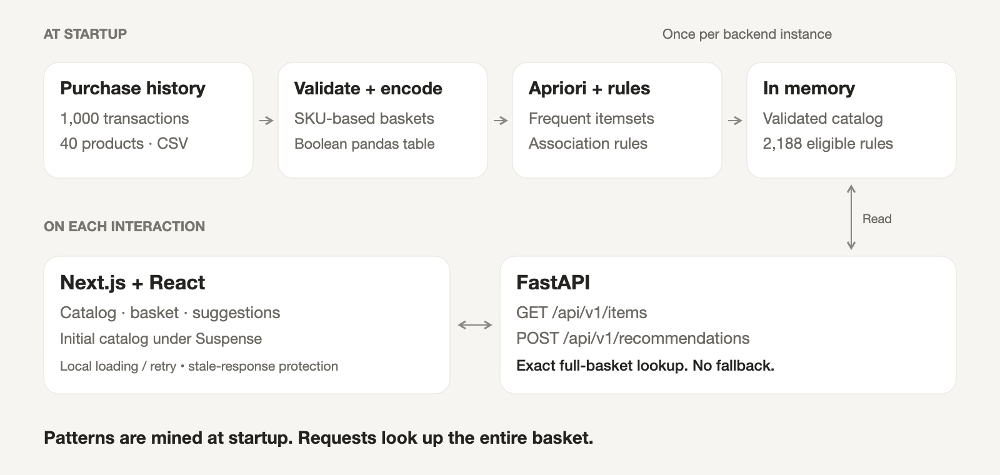

# A basket. A better next choice.
Tandem discovers products purchased together, then responds to the basket you build.
<empty-block/>
<columns>
	<column>
		## 1,000
		Recorded transactions {color="gray"}
	</column>
	<column>
		## 40
		Distinct products {color="gray"}
	</column>
	<column>
		## One basket
		The complete context {color="gray"}
	</column>
</columns>
---
# Find the pattern. Respect the evidence.
**Apriori** finds frequent product combinations. Association rules turn those combinations into possible next items.
<empty-block/>
<columns>
	<column>
		## 0.2%
		Minimum support At least two transactions
	</column>
	<column>
		## 10%
		Minimum confidence Among baskets with the antecedent
	</column>
	<column>
		## > 1
		Required lift Above the item's overall frequency
	</column>
</columns>
A small dataset. Explicit thresholds. No automatic fallback. {color="gray"}
---
# Five baskets tell a story.
**CO detector + Dahua camera → Hikvision camera**
<empty-block/>
<columns>
	<column>
		## 0.5%
		Support 5 of 1,000 transactions contain all three
	</column>
	<column>
		## 35.7%
		Confidence 5 of 14 baskets with the pair contain the suggestion
	</column>
	<column>
		## 3.54×
		Lift Confidence ÷ the suggestion's overall frequency
	</column>
</columns>
Observed co-purchases. Not an accuracy score or a compatibility guarantee. {color="gray"}
---
# Mine once. Match every change.

---
# The whole basket matters.
**Start with Bosch. Add Honeywell. Then Hikvision.**
A supported three-product basket recommends Hanwha.
Swap Hikvision for Axis: suggestions disappear. Remove Axis to restore the pair.
<empty-block/>
**No quantities. No duplicates. No fallback.**
---
# Thoughtful suggestions. Clear limits.
A calm interface. A transparent algorithm. Recommendations grounded in the supplied data.
<empty-block/>
**Tandem**
A better next choice. Grounded in past purchases.

