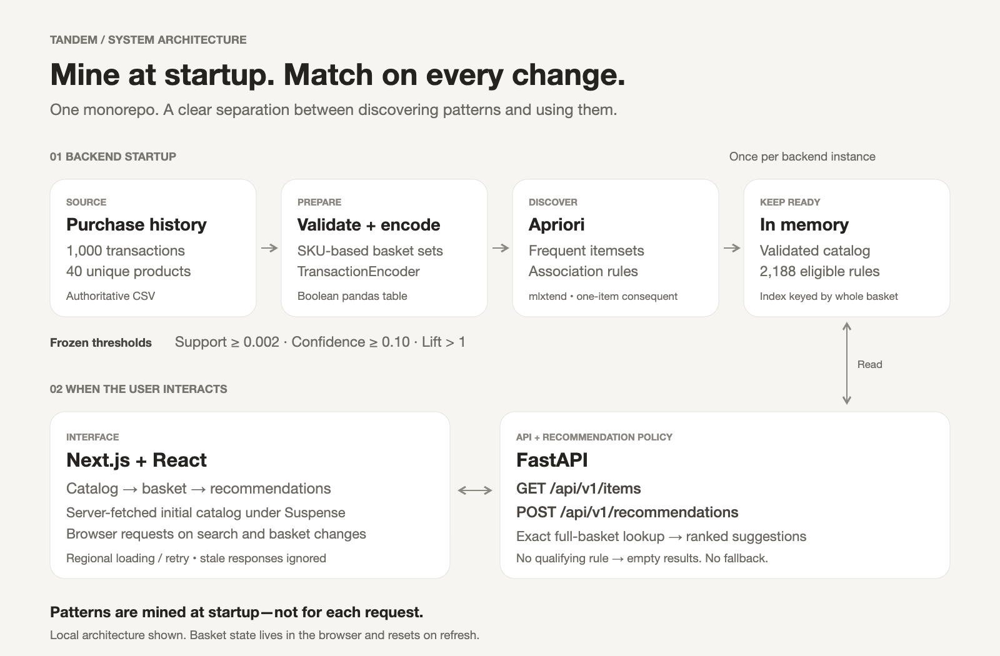

# Tandem — read-aloud demo script

## Current configuration and demo scope

Support **0.2%**, confidence **10%**, lift **strictly above 1**. The model uses the entire selected basket without fallback. Demonstrate one, two and three selected products; this is a presentation scope, not a basket cap. Suggestions still default to at most five.

The supplied 1,000 transactions yield 2,188 qualifying rules covering 40 single-item baskets, 624 pairs and 59 triples. These are counts of baskets with recommendations, not prediction accuracy. Only 59 of the 9,880 possible triples qualify, so use the verified path below.

**Target:** approximately 3–4 minutes including calibration and live interaction. Timing is an estimate; rehearse at your natural pace. Read quoted text; the other text is stage direction.

**Audience page:** [Tandem presentation](https://app.notion.com/p/3fde7d562b8181fa9a30e1a95cc96090)

## Before recording

Open the presentation and [Tandem workspace](https://tandem-three-lyart.vercel.app/recommender) in separate tabs. Clear the basket. Keep this guide outside the recording area. Enter Notion Presentation Mode with **⌘ Option P**; use arrow keys to advance and Escape to leave. Switch to the pre-opened app for the walkthrough.

## Opening — purpose

**Show:** “A basket. A better next choice.”

> “Meet Tandem. It recommends products based on what people bought together. We start with one thousand recorded transactions and forty products. You build a basket, and Tandem looks for a relevant next item.”

## Algorithm and configuration

**Advance:** “Find the pattern. Respect the evidence.”

> “We use Apriori to find frequent product combinations, then generate association rules. Our current settings require at least point-two percent support, ten percent confidence, and lift above one. In this dataset, the support threshold means a combination must appear in at least two transactions.”

> “We compared different settings before choosing those values. The earlier half-percent support and fifteen-percent confidence settings produced recommendations for only twelve individual products and three pairs. Lowering confidence to ten percent gave every individual product a recommendation, but still left only three pairs. Support was also limiting coverage.”

> “A three-transaction minimum gave us one hundred ninety pairs but no triples. A two-transaction minimum gave us six hundred twenty-four pairs and fifty-nine triples. We also tested a one-transaction minimum. It produced many more suggestions, but more than eighty-three percent of displayed basket-to-suggestion entries then depended on just one observation.”

> “We chose the two-transaction minimum and focused the demo on baskets of up to three products. This gives us more useful examples while excluding rules supported by only one transaction. It is still a small dataset; more coverage does not prove better predictive accuracy.”

## Make the metrics concrete

**Advance:** “Five baskets tell a story.” This particular rule still has 0.5% support even though the minimum threshold is now 0.2%.

> “Here is one real rule. Five transactions contain this detector and both cameras. That is half a percent support. Five of the fourteen baskets containing the starting pair include the suggested camera: thirty-five-point-seven percent confidence. Lift is about three-point-five-four, relative to that camera's overall frequency.”

## Architecture

**Advance:** “Mine once. Match every change.”

> “The Python backend validates the CSV and mines rules once when it starts. Next.js handles the interface. FastAPI serves the catalog and matches the complete basket against rules in memory. Changing the basket performs a lookup; it does not retrain the model. Both services are hosted on Vercel from the same repository.”

## Live demonstration — one, two, three products

**Advance:** “The whole basket matters.” Switch to the app.

1. Clear the basket. Search `B5512` and add **Bosch B5512 Control Panel**. Three suggestions appear. Point to **Honeywell 6160 Keypad**, the third suggestion.
2. Add that Honeywell keypad (`6160`) from recommendations. Four suggestions appear. The first is **Hikvision 4MP IP Camera** (`DS-2CD2142FWD-I`).
3. Add that Hikvision camera. The three-product basket recommends **Hanwha QND-6010R Network Camera** (`QND-6010R`). Do not add Hanwha; stop at three selected products.
4. Remove Hikvision first, returning to the Bosch/Honeywell pair. Search and add **Axis M3046-V Network Camera** (`0806-001`). The new three-product basket has no recommendations.
5. Remove Axis. The four pair recommendations return.

> “The Bosch panel now gives us suggestions. I can add this Honeywell keypad, then this Hikvision camera. With three products selected, Tandem still finds a suggestion: the Hanwha camera. That rule appears in two of the three transactions containing our selected trio, so its confidence is about sixty-seven percent. That is a real pattern, but a small sample.”

> “Now I swap the Hikvision camera for Axis. There is no qualifying rule for this entire basket, so suggestions disappear. Removing Axis restores the recommendations for the pair. Tandem always matches the complete selection.”

## Close

Return to the presentation's closing slide.

> “These are observed co-purchase patterns, not compatibility guarantees or measured prediction accuracy. Tandem makes those patterns useful through a simple, responsive shopping experience.”

## Rehearsal test cases — exact expected order

Clear the basket before each independent case. Search by SKU; changing the search preserves the basket. Wait for loading to finish. These expectations use the default five-suggestion limit.

| Case | Selected SKUs | Expected suggestion SKUs, in order |
| --- | --- | --- |
| Single | `B5512` | `DS-7608NI-I2/8P`, `60-848-02-95R`, `6160` |
| Pair | `B5512`, `6160` | `DS-2CD2142FWD-I`, `HEN08104`, `QND-6010R`, `DS-7608NI-I2/8P` |
| Triple | `B5512`, `6160`, `DS-2CD2142FWD-I` | `QND-6010R` |
| Unsupported triple | `B5512`, `6160`, `0806-001` | None; removing Axis restores the pair row |
| Earlier example, updated result | `60-652-95R`, `DH-IPC-HDBW4431R-ZS` | `DS-2CD2142FWD-I`, `PG9914`, `5808W3`, `HEN08104`, `VISTA-20P` |
| Empty | No products | Empty-basket guidance, no suggestions |

Bosch alone is now a positive test. The earlier 0.5%/15% checklist is obsolete and must not be used as the current expected output.

## Configuration comparison for questions

All rows require lift strictly above one. Counts are distinct selected baskets with at least one recommendation.

| Support / confidence | Singles / pairs / triples | Decision |
| --- | --- | --- |
| 0.5% / 15% | 12 / 3 / 0 | Previous configuration; too sparse for the intended demo. |
| 0.5% / 10% | 40 / 3 / 0 | Confidence alone improves singles, not pairs. |
| 0.4% / 10% | 40 / 15 / 0 | Limited improvement; no triples. |
| 0.3% / 10% | 40 / 190 / 0 | More pairs; no triples. |
| **0.2% / 10%** | **40 / 624 / 59** | **Selected: at least two supporting transactions.** |
| 0.1% / 10% | 40 / 777 / 3,172 | Rejected: 83.46% of displayed basket-to-suggestion entries depend on one transaction. |

Four- and five-product demo coverage is not an objective. The selected setting has no recommendations for baskets that size. Possible denominators are 40 singles, 780 pairs and 9,880 triples. No held-out accuracy evaluation is claimed.

## Architecture reference

[Editable draw.io source](architecture.drawio). Next.js and FastAPI are deployed together on Vercel; the local single-command runtime uses the same model policy.

## Technical appendix

- **Support:** count of transactions containing the selected basket and suggested product together, divided by 1,000.
- **Confidence:** joint count divided by the count containing the selected basket.
- **Lift:** confidence divided by the suggested product's overall frequency.
- **Triple example:** Bosch + Honeywell + Hikvision occurs three times; adding Hanwha occurs twice. Support 0.2%, confidence 2/3, lift approximately 7.17. High lift does not remove the small-sample limitation.
- **Apriori pruning:** every subset of a frequent itemset must itself be frequent. Apriori uses this property to discard candidates whose subsets fail support.
- **Runtime:** mine once per backend instance; full-basket equality; exclude selected products; rank by confidence, lift, support, then SKU. No fallback or per-click threshold adjustment.
- **UI:** unique items, no quantities, refresh resets the basket. Obsolete suggestions clear immediately; late requests cannot replace current results. Loading and retry stay local to each region.
- **Evidence:** [calibration report](../../server/MODEL_REPORT.md), [historical research](../calibration-demo-analysis.md). Previous MP4 rehearsals document earlier app versions; the new calibration recording accompanies this change.
